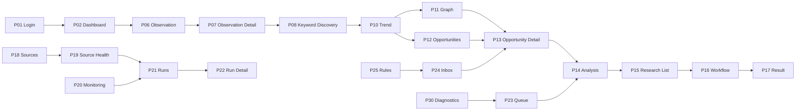

# Opportunity Radar R02 — 全局页面交互流程

## F01 认证与权限

1. P01 --成功--> P02
2. 任意认证页 --Session Expired--> P01
3. 任意认证页 --403--> P04
4. 不存在/已删除对象 --> P05

## F02 机会发现主链

1. P18 Source -> 后台采集
2. P06 -> P07
3. P07/P06 -> P08
4. P08/P09 -> P10
5. P10 -> P11
6. P10/P11/P06 -> P12
7. P12 -> P13

## F03 分析与研究

1. P13 -> P14
2. P13/P14 --现有能力--> P15/P16
3. P15 -> P16
4. P16 -> P17
5. P17 -> P13/P06/P07
6. P23 -> P13/P14/P22

## F04 采集与运行

1. P18 -> P19
2. P18/P19 -> P20
3. P19/P20 -> P21
4. P21 -> P22
5. P22 -> P19/P13/P16/P07

## F05 告警

1. P25 规则 -> 后台评估 -> P24 Inbox
2. P24 Drawer -> P13/P25
3. P25 触发记录 -> P24

## F06 管理

1. P27 -> OWNER Risk Modal -> 现有Admin User API
2. P27变更 -> P26可审计
3. P28密码/Session/API Token
4. P29-A~E仅现有Settings schema/API
5. P30 -> P21/P18/P19/P23

## F07 全局搜索

1. TopBar -> P03
2. P03 Opportunity -> P13
3. P03 Observation -> P07
4. P03 Keyword -> P10/P09
5. P03 Research -> P16/P17

## 统一异常流

- `401 / Session Expired` → P01。
- `403` → P04。
- `404 / Object Deleted` → P05。
- `429` → 当前页 Rate Limited；登录限流留在 P01。
- 区域读取失败 → 保留页面 Shell 与成功区域，只在失败区域 Error + Retry。
- 写操作失败 → 保留 Drawer/Modal/表单上下文，展示服务端错误，禁止前端伪造成功。
- `409 Conflict` → 保留输入并提示冲突；OWNER 不变量以服务端为准。
